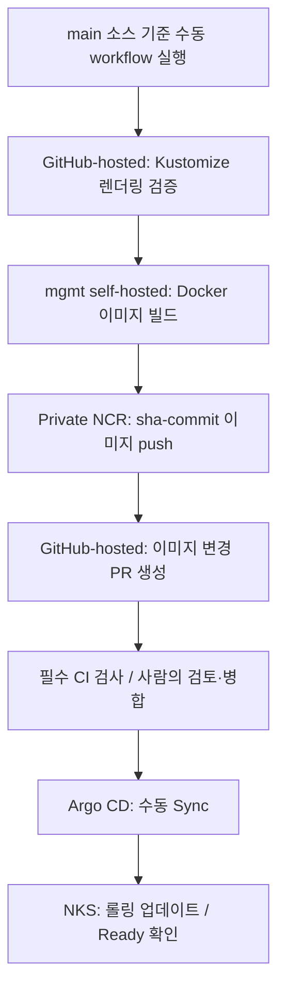
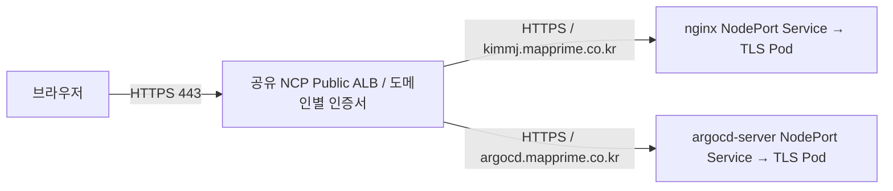

# NCP NKS DevOps Lab

Naver Cloud Platform의 관리형 Kubernetes(NKS)에서 **이미지 빌드·배포 변경 PR·수동 GitOps 배포·HTTPS 서비스 공개**를 구성하고, 장애를 재현·분석한 학습 프로젝트입니다.

설치 성공뿐 아니라 HPA 확장, PDB 기반 유지보수, 롤링 업데이트·롤백, 필수 CI 병합 차단, TLS 연결 및 GitOps 리소스 참조 문제를 검증했습니다.

> 실제 클라우드에서 수행한 학습 프로젝트입니다. 고객 운영 경력과 구분하며 대규모 트래픽 운영·무중단 보장·성능 개선 수치를 주장하지 않습니다.
>
> 최종 기록: 2026-10-15. 클러스터 결과는 실습 중 수집한 터미널 출력·화면 기준입니다.

## 1. 핵심 결과

| 영역 | 구현·검증 결과 |
|---|---|
| 네트워크 | ACG 제한 이후 API·Konnectivity·DNS 경로를 진단하고 로그 조회·Metrics API 복구 |
| Registry | Docker 이미지 빌드, NCR Private Endpoint push 및 인증된 worker image pull |
| CI | GitHub-hosted 렌더링 검증 → self-hosted 이미지 빌드·push → 배포 PR 생성 |
| GitOps | 사람이 PR을 병합한 뒤 Argo CD Manual Sync, SHA 이미지 Pod 3개 Ready |
| 변경 통제 | Manifest validation 필수 검사 실패 시 main 병합 버튼 비활성화 확인 |
| 확장 | CPU 목표 60%, min 3 / max 6 HPA에서 Pod 3 → 5 → 6 확장 |
| 배포·유지보수 | v2 롤링 업데이트·롤백·재적용, 양쪽 노드의 nginx Pod 선택적 drain |
| 앱 범위 제한 | 전용 AppProject에서 저장소·대상 namespace·리소스 종류 제한 |
| HTTPS | 공유 ALB 443에서 도메인별 인증서·Route 구성, 외부와 backend 모두 HTTPS |
| 최종 상태 | Argo CD Synced / Healthy, nginx Pod 3개 Ready, 약 152분 시점 재시작 0 |

마지막 항목은 두 차례 상태 조회에서 확인한 결과이며 장기 가용성·연속 무중단 측정은 아닙니다.

## 2. 기술 구성

| 구분 | 구성 |
|---|---|
| Cloud / Cluster | NCP VPC / NKS Kubernetes v1.36.2 / Worker 2대 |
| Network | Cilium / NCP Public ALB / Gateway API |
| Container / Registry | Docker / NCP Container Registry |
| Application | nginx 정적 페이지 |
| CI | GitHub Actions / hosted 검증·PR job / self-hosted 빌드 job |
| CD / Manifest | Argo CD Manual Sync / Kustomize |
| 운영 정책 | HPA, PDB, HTTPS Probe, RollingUpdate, soft Topology Spread |
| TLS | 외부 NCP Certificate Manager / nginx 내부 자체 서명 인증서 / Argo CD 서버 TLS |

Secret Manager CSI 연동은 실습 후 일반 imagePullSecret으로 전환했고 전용 구성 제거 및 콘솔 이용 해지를 완료했습니다.

## 3. CI/CD 흐름



- CI는 클러스터에 직접 배포하지 않고 Git에 변경을 제안합니다.
- 빌드는 workflow_dispatch로 실행하며, PR 병합과 Argo CD Sync도 수동입니다.
- SHA 태그로 소스와 이미지의 관계를 추적합니다. 태그 불변성·digest 고정을 보장하는 것은 아닙니다.
- HPA가 Pod 수를 관리하도록 Deployment replicas를 생략하고 Argo CD의 비교·동기화 제외 정책을 구성했습니다.

## 4. HTTPS 접근 구조



- Gateway Listener는 HTTPS 443만 선언합니다. HTTP 80 Listener는 제거한 구성입니다.
- nginx와 Argo CD는 각각 HTTPRoute의 hostnames로 구분합니다.
- Route 연결 namespace는 web-app과 argocd로 제한합니다.
- ALB backend와 health check는 HTTPS이며 /healthz를 사용합니다.
- nginx 자체 HTTPS는 port-forward 및 curl --cacert로 인증서·호스트명 검증을 확인했습니다.
- 외부 두 도메인은 -k 없이 공인 인증서 검증 및 /healthz의 HTTP 200을 확인했고, 브라우저 접속도 확인했습니다.
- ALB가 TLS를 한 번 종료한 뒤 backend와 별도 TLS 연결을 맺는 **재암호화** 구성입니다. TLS passthrough나 mTLS가 아닙니다.
- **ALB의 backend 인증서 신뢰·호스트명 검증 정책까지 검증한 것은 아닙니다.**

현재 두 도메인은 실습을 위해 전체 공개 상태입니다. 관리자 UI의 IP 제한·VPN·SSO/MFA는 후속 보안 과제입니다. 공개 접속을 운영 권장안으로 제시하지 않습니다.

## 5. GitOps·리소스 관리 경계

| 대상 | 관리 방식 |
|---|---|
| nginx Deployment / Service / HPA / PDB / 생성 ConfigMap | Argo CD nginx-web Application |
| AppProject / Application 선언 | Git 보관, 별도 kubectl 적용 |
| Gateway / LoadBalancerTemplate / HTTPRoute | Git 보관, 별도 kubectl 적용 |
| Argo CD 설치·Service | Helm 사용자 정의 values |
| 이미지 pull / nginx TLS Secret | Git 제외, 별도 생성·관리 |

AppProject는 특정 저장소, web-app namespace, Deployment·Service·ConfigMap·HPA·PDB만 허용하고 클러스터 범위 리소스는 허용하지 않습니다. 금지 대상 배포의 부정 테스트는 아직 완료하지 않았습니다.

## 6. 주요 운영 정책

| 설정 | 목적 / 한계 |
|---|---|
| HPA min 3 / max 6 / CPU 60% | CPU 기반 확장; 요청 처리량·지연의 성능 개선을 증명하지 않음 |
| maxSurge 1 / maxUnavailable 0 | 점진적 교체; 추가 자원과 Probe 품질에 의존 |
| PDB minAvailable 2 | 자발적 eviction 제한; 노드 장애·직접 삭제·롤링 업데이트 자체를 제어하지 않음 |
| hostname / ScheduleAnyway | soft 분산; 2:1 배치를 확인했으나 균등 배치 보장 아님 |
| HTTPS readiness/liveness Probe | 앱 수신 상태 점검; kubelet HTTPS Probe는 인증서 검증을 하지 않음 |
| configMapGenerator + namespace: web-app | 내용 해시와 Deployment 참조 일치, 설정 변경 시 rollout 유도 |

drain은 nginx Pod만 선택한 테스트이며 전체 노드 drain·재부팅·강제 장애 시험이 아닙니다.

## 7. 장애 해결 사례

| 증상 | 확인한 근거 | 조치·결과 |
|---|---|---|
| Metrics API·kubectl logs 실패 | API·Konnectivity·DNS 경로 및 Agent 인자 | ACG 경로 복구 후 Metrics·로그 조회 확인 |
| private image pull 403 | 통신 성공과 인증 실패 구분 | 같은 namespace의 dockerconfigjson Secret 연결 |
| CSI mount·Secret 동기화 실패 | volumeMount 누락, 키 오타, JSON 문자열/객체 차이 | 원인별 수정 후 Pod 실행, 이후 일반 Secret 전환 |
| Helm NodePort 30080 충돌 | 기존 nginx가 30080 사용 | Argo CD chart nodePortHttp/nodePortHttps를 0으로 설정해 자동 할당 |
| 새 Pod FailedMount | 생성 ConfigMap에는 해시, Deployment에는 기본 이름 | Kustomize namespace를 통일해 참조 변환 확인 및 rollout 복구 |
| Argo CD 외부 503 | NoMatchingParent, 예전 Listener sectionName 참조 | Route sectionName을 https로 맞춰 연결 복구 |
| nginx 외부 TCP timeout | 관리 서버 DNS가 이전 IP 반환 | DNS 경로 정정·반영 후 HTTPS 200 확인 |
| 로컬 브라우저 timeout | 관리 서버 HTTPS는 성공, 로컬 접속은 실패 | 명시적 HTTPS·로컬 DNS 점검 안내 후 사용자 접속 성공 확인 |
| Healthy인데 OutOfSync | 새 해시 ConfigMap과 정리 대상 이전 ConfigMap 공존 | 미사용 여부 확인·선택적 정리 안내 후 최종 Synced/Healthy 확인 |
| CI 실패해도 병합 가능 | 실패 탐지와 필수 검사 강제가 별개 | 보호 규칙 적용 후 별도 PR로 병합 차단 검증 |

로컬 브라우저 문제는 조치 후 접속 성공을 확인했지만 HTTP 접속인지 DNS 캐시인지 단일 원인을 확정하지 않았습니다. ConfigMap 실제 삭제 명령·이벤트는 미수집이며 최종 상태로 정리 결과를 확인했습니다.

## 8. 저장소 구조

```text
.github/workflows/
├── validate.yaml
└── build.yaml
app/
├── Dockerfile
└── index.html
gitops/
├── apps/
│   ├── nginx-web/
│   │   ├── deployment.yaml
│   │   ├── service.yaml
│   │   ├── hpa.yaml
│   │   ├── pdb.yaml
│   │   ├── nginx.conf
│   │   └── kustomization.yaml
│   └── argocd/
│       ├── nginx-argocd.yaml
│       └── nginx-project.yaml
└── infra/
    ├── gateway/
    │   ├── loadbalancer-template.yaml
    │   ├── gateway.yaml
    │   ├── httproute.yaml
    │   └── kustomization.yaml
    └── argocd-gateway/
        └── httproute.yaml
```

## 9. 변경·검증 근거

- [이미지 배포 PR #1](https://github.com/manmanjae/ncp-nks-devops/pull/1)
- [연결된 이미지 빌드 실행](https://github.com/manmanjae/ncp-nks-devops/actions/runs/38329261675)
- [CI 실패·수정 테스트 PR #2](https://github.com/manmanjae/ncp-nks-devops/pull/2) — 미병합 종료
- [필수 검사 병합 차단 PR #3](https://github.com/manmanjae/ncp-nks-devops/pull/3) — 미병합 종료
- [nginx HTTPS 전환 PR #7](https://github.com/manmanjae/ncp-nks-devops/pull/7)
- [공유 HTTPS Gateway PR #9](https://github.com/manmanjae/ncp-nks-devops/pull/9)

PR은 변경 이력의 근거입니다. 최초 PR 뒤 추가 수정이 있었으며, 최종 동작은 실습 출력·화면과 최종 Git 파일을 함께 기준으로 기록했습니다. 대외 공개 리소스는 실습 종료 시 중지·삭제할 수 있어 상시 데모 URL을 보장하지 않습니다.

## 10. 재현 전 확인

- NKS, 관련 Add-on·GatewayClass·CRD, LB 서브넷 및 접근 경로를 별도 준비해야 합니다.
- Registry·namespace·도메인·인증서 번호·서브넷 ID는 본인 환경에 맞게 변경합니다.
- 현재 Dockerfile은 기존 Private NCR SHA 이미지에 의존하며 해당 이미지에 대한 접근 권한이 필요합니다.
- web-app/ncr-local-secret, web-app/nginx-backend-tls는 별도로 생성합니다. 개인키·토큰·kubeconfig·Secret 원문은 커밋하지 않습니다.
- mgmt Docker 로그인 정보는 worker의 imagePullSecret을 대신하지 않습니다.
- Public repo의 신뢰할 수 없는 PR을 관리 서버 self-hosted Runner에서 실행하지 않습니다.
- 전체 자동 구축 저장소가 아닙니다. 유료 리소스 생성·해지와 키 교체는 별도 운영 절차가 필요합니다.
- 내부 인증서 변경 후 nginx 재시작/rollout이 필요하며, ConfigMap subPath mount도 자동 reload를 보장하지 않습니다.
- 이전 ConfigMap을 정리하면 옛 ReplicaSet의 직접 rollback에 영향이 있을 수 있어 Git에서 설정을 복원하는 rollback을 사용합니다.

## 11. 미완료 항목

- Python·Go 기반 독립적인 운영 도구 개발: **아직 시작 전**
- NKS 모니터링·로깅·알림·SLO 및 연속 오류율·지연 측정
- IaC 재구축, 백업·복구, 실제 대규모·다중 클러스터 운영 검증
- AppProject 금지 대상 테스트, Runner 격리, 관리자 접근 제한·인증 강화
- backend 인증서 신뢰 검증 정책 확인, CA·인증서 자동 갱신·만료 감시
- Kubernetes 스키마 검사, 이미지 취약점 검사, digest 고정·서명
- workflow 미사용 output·주석 정리, argocd-gateway 신규 경로의 CI 검증 보강

Python 표준 라이브러리 기반 HTTPS 점검 CLI를 구현하고, 정상 응답·HTTP 오류·연결 오류에 대한 단위 테스트 3개와 GitHub Actions 자동 테스트를 추가했습니다. PR #11에서 검사 통과 후 main에 병합했습니다.

## Python HTTPS 점검 도구

URL의 HTTP 상태와 응답 헤더 수신까지의 소요 시간을 확인하는 CLI 도구입니다.
Python 표준 라이브러리만 사용합니다.

### 실행

```bash
python3 tools/https_check.py https://YOUR_DOMAIN/healthz
```

### 종료 코드

| 코드 | 의미 |
|---|---|
| 0 | 요청 정상 처리 |
| 1 | HTTP 오류 또는 연결 오류 |
| 2 | URL 인자 누락 또는 개수 오류 |

### 자동 테스트

```bash
python3 -m unittest discover -s tests -v
```

Mock을 사용해 실제 서버 요청 없이 정상 응답·HTTP 404·연결 오류를 검증합니다.
GitHub Actions에서 main 대상 PR과 main push 시 테스트를 실행합니다.

### 검증 범위와 한계

- HTTP 상태와 요청 소요 시간을 확인합니다.
- 응답 본문·DB 연결·전체 업무 기능의 정상 여부는 검증하지 않습니다.
- 자동 테스트는 오류 처리 로직을 검증하며 실제 서비스 가용성 점검과는 구분합니다.
