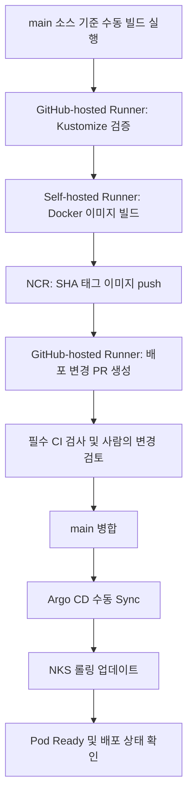

# NCP NKS DevOps Lab

Naver Cloud Platform의 관리형 Kubernetes(NKS)에서 컨테이너 배포와 운영 정책을 구성하고, GitHub Actions와 Argo CD를 연결한 학습 프로젝트입니다.

단순 설치에 그치지 않고 네트워크 장애 해결, 자동 확장, 롤링 업데이트·롤백, 유지보수 중 중단 보호, CI 실패 시 병합 차단까지 검증했습니다.

> 실제 클라우드 환경에서 수행한 실습입니다. 본 프로젝트를 대규모 운영 경험이나 무중단·고가용성 보장으로 표현하지 않습니다.
>
> 기록 기준: 2026-10-13

## 1. 프로젝트 목표

- NCP 네트워크와 NKS의 통신 경로 이해
- Private Registry 기반 이미지 빌드·배포 구성
- Kubernetes 배포·확장·중단 보호 정책 검증
- CI와 CD를 분리한 승인형 GitOps 흐름 구현
- 실패 상황을 재현하고 로그와 상태를 근거로 문제 해결

## 2. 기술 구성

| 구분 | 구성 |
|---|---|
| Cloud | Naver Cloud Platform |
| Kubernetes | NKS v1.36.2 / Worker 2대 |
| CNI | Cilium |
| Application | nginx |
| Container | Docker |
| Registry | NCP Container Registry(NCR) |
| 외부 접속 | NCP Public ALB + Gateway API |
| Manifest | Kubernetes YAML + Kustomize |
| CI | GitHub Actions |
| Build Runner | 관리 서버의 self-hosted Runner |
| CD | Argo CD / Manual Sync |
| 운영 정책 | HPA, PDB, Probe, RollingUpdate, Topology Spread |

Secret Manager CSI 연동도 실습했으며, 이후 비용과 관리 단순성을 고려해 일반 imagePullSecret으로 전환했습니다.

## 3. CI/CD 흐름



- 이미지 태그에 소스 commit SHA를 사용해 변경 이력을 추적합니다.
- CI는 Kubernetes에 직접 배포하지 않고 이미지 변경 PR을 생성합니다.
- 사람이 PR을 검토·병합한 뒤 Argo CD에서 수동 동기화합니다.
- main에는 필수 `Manifest validation` 검사를 적용했습니다.
- 빌드는 현재 수동 실행 방식이며 완전 자동 배포는 아닙니다.

## 4. 서비스 접근 구조

```text
사용자 HTTP 요청
    ↓
NCP Public ALB
    ↓
Gateway / HTTPRoute에 선언된 라우팅
    ↓
nginx-web NodePort Service
    ↓
nginx Pod
```

Gateway와 HTTPRoute는 ALB의 라우팅을 선언하는 리소스입니다.

앱 리소스는 Argo CD가 관리하며, Gateway·ALB 구성은 현재 앱 Application의 관리 범위에서 제외했습니다.

## 5. 주요 검증 결과

| 영역 | 수행 내용 | 확인한 결과 |
|---|---|---|
| 네트워크 | ACG 제한 이후 API·Konnectivity·DNS 경로 진단 | Metrics API와 로그 조회 복구 |
| Registry | NCR push 및 인증된 private image pull | nginx Pod 실행 성공 |
| 외부 접속 | Public ALB·Gateway·HTTPRoute 구성 | 브라우저와 curl로 nginx 응답 확인 |
| 자동 확장 | CPU 기반 HPA 구성 | 부하 시 Pod 3 → 5 → 6개 확장 |
| 버전 변경 | v2 롤링 업데이트·이전 버전 롤백·v2 재적용 | 버전 전환과 앱 응답 확인 |
| 중단 보호 | PDB를 적용한 양쪽 노드의 앱 선택적 drain | eviction 제한 및 대체 Pod 준비 후 진행 |
| 분산 배치 | hostname 기준 soft topology spread | 두 노드에 Pod 2:1 배치 확인 |
| CI | 이미지 빌드·NCR push·배포 PR 생성 | SHA 이미지 변경 PR 생성 성공 |
| GitOps | Argo CD 수동 Sync | 새 이미지 Pod 3개 Ready, Synced / Healthy |
| 변경 통제 | 의도적인 파일 누락 오류 주입 | 필수 CI 실패 시 Merge 버튼 비활성화 |

### 검증 범위에 대한 주의

- drain은 nginx 앱 Pod만 선택한 테스트이며 전체 노드 drain·재부팅 테스트는 아닙니다.
- 롤링 업데이트 중 연속 요청의 오류율·지연시간은 측정하지 않았습니다.
- Kustomize 렌더링 검사는 모든 Kubernetes 스키마 오류나 보안 문제를 검출하지 않습니다.
- SHA 태그는 소스 추적용이며 이미지 digest 고정과 동일하지 않습니다.

## 6. 주요 설계 판단

### CI와 CD 분리

빌드 Runner가 클러스터에 직접 배포하지 않도록 구성했습니다.
CI는 변경 PR을 제안하고, 배포는 Git에 병합된 선언을 Argo CD가 적용합니다.

### HPA와 GitOps의 관리 충돌 방지

Deployment에서 고정 replicas를 제외하고, Argo CD에서 `/spec/replicas` 비교를 무시하도록 설정했습니다.

`RespectIgnoreDifferences=true`를 사용해 동기화 시에도 HPA가 관리하는 replica 수를 존중합니다.

### 배포와 유지보수 정책 구분

- RollingUpdate: `maxSurge: 1`, `maxUnavailable: 0`
- PDB: `minAvailable: 2`
- HPA: 최소 3개, 최대 6개, CPU 목표 60%
- Topology Spread: `ScheduleAnyway`

PDB는 자발적인 eviction을 제한합니다. 노드 장애나 Deployment 롤링 업데이트 자체를 제어하는 설정은 아닙니다.

### 실패 탐지에서 병합 차단까지 검증

먼저 잘못된 파일 참조로 CI 실패를 확인했습니다.
이후 main 보호 규칙에 필수 검사를 지정하고, 별도 실패 PR로 실제 병합 차단까지 검증했습니다.

## 7. 장애 해결 사례

| 증상 | 진단 및 해결 |
|---|---|
| Metrics API 및 kubectl logs 실패 | API·Konnectivity·DNS 통신 경로를 구분하고 ACG 점검 후 복구 |
| Private 이미지 pull 403 | 통신 성공과 인증 성공을 구분하고 imagePullSecret 구성 |
| CSI 동기화 Secret 생성 안 됨 | Pod의 volumeMount 누락을 확인하고 수정 |
| Secret Manager key not found | 저장된 키 이름과 secretKey의 오타 수정 |
| dockerconfigjson 타입 오류 | JSON 문자열과 객체 구조를 구분해 수정 |
| CI 실패에도 병합 가능 | main 필수 상태 검사 설정 후 병합 차단 재검증 |

Secret Manager 연동 성공 후 일반 `ncr-local-secret`으로 전환했고, 전용 CSI 구성 제거와 콘솔 이용 해지를 완료했습니다.

## 8. 저장소 구조

```text
.github/workflows/
├── validate.yaml                # PR·main 매니페스트 렌더링 검증
└── build.yaml                   # 수동 빌드·push·배포 PR 생성

app/
├── Dockerfile
└── index.html

gitops/
├── apps/
│   ├── nginx-web/
│   │   ├── deployment.yaml
│   │   ├── service.yaml
│   │   ├── hpa.yaml
│   │   ├── pdb.yaml
│   │   └── kustomization.yaml
│   └── argocd/
│       └── nginx-argocd.yaml     # Application 부트스트랩 선언
└── infra/
    └── gateway/
        ├── loadbalancer-template.yaml
        ├── gateway.yaml
        ├── httproute.yaml
        └── kustomization.yaml
```

## 9. 검증 이력

- [배포 PR #1](https://github.com/manmanjae/ncp-nks-devops/pull/1)
  - CI가 생성한 SHA 이미지 변경 PR
  - 병합 후 Argo CD 동기화 및 새 이미지 배포 확인
- [이미지 빌드 실행](https://github.com/manmanjae/ncp-nks-devops/actions/runs/38329261675)
- [CI 실패·수정 테스트 PR #2](https://github.com/manmanjae/ncp-nks-devops/pull/2)
  - 존재하지 않는 파일 참조로 실패 유도
  - 수정 후 검사 성공, 미병합 종료
- [필수 검사 병합 차단 PR #3](https://github.com/manmanjae/ncp-nks-devops/pull/3)
  - 필수 Manifest validation 실패
  - Merge 버튼 비활성화 확인, 미병합 종료

클러스터 검증 결과는 실습 중 수집한 터미널 출력과 화면을 기준으로 기록했습니다.

## 10. 재사용 조건과 보안

- NKS와 관련 Gateway API·NCP Add-on이 필요합니다.
- NCR 주소와 LB 서브넷 설정을 본인 환경에 맞게 변경해야 합니다.
- `web-app/ncr-local-secret`은 별도로 생성해야 합니다.
- 현재 Dockerfile은 기존 NCR의 `nginx-lab:v1` 이미지에 의존합니다.
- 이 저장소만 clone하면 클라우드 전체 환경이 자동 구축되지는 않습니다.
- 인증키·토큰·kubeconfig·Secret 원문은 저장소에 포함하지 않습니다.
- 관리 서버의 Docker 로그인 정보만으로 워커 이미지 pull 인증이 설정되지는 않습니다.
- Public 저장소의 신뢰할 수 없는 PR을 self-hosted Runner에서 실행하지 않습니다.

## 11. 현재 한계 및 개선 계획

- 관리 서버에 배치한 Runner를 전용 또는 일회성 환경으로 격리
- workflow의 미사용 이미지 output 선언과 주석 정리
- Kubernetes 스키마 검증 및 이미지 취약점 검사 추가
- Argo CD의 scoped AppProject와 권한 경계 구성
- 모니터링·로그·알림 및 배포 전후 오류율·지연시간 측정
- 전용 도메인과 HTTPS 구성
- Terraform·Ansible 기반 재구축 자동화
- 환경별 Kustomize 구성 및 백업·복구 검증

현재 Argo CD는 비HA 실습 구성이고 Public ALB는 HTTP를 사용합니다.
운영 환경으로 전환하려면 권한·보안·관측성·복구 정책을 추가로 검증해야 합니다.
